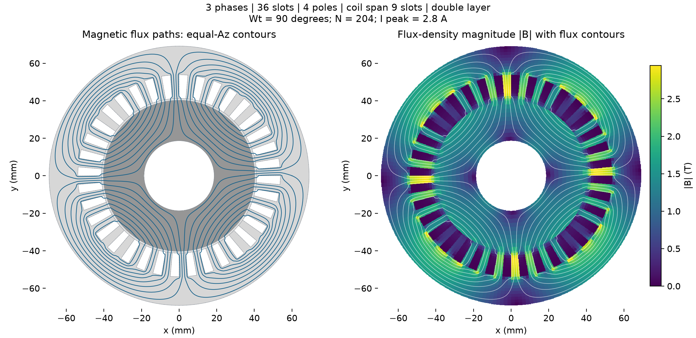
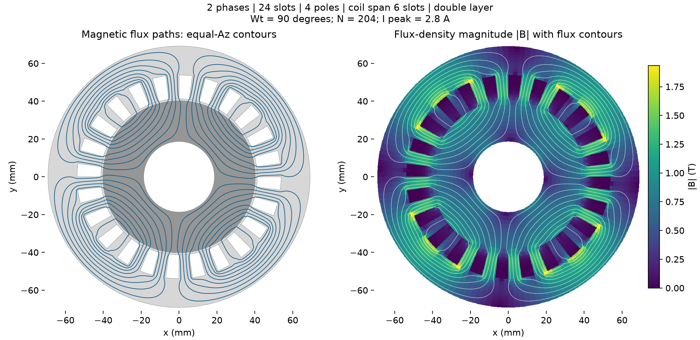
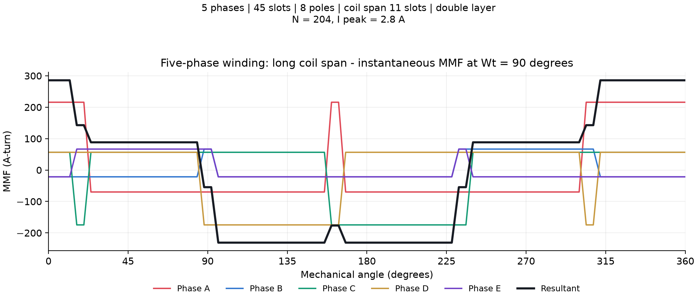
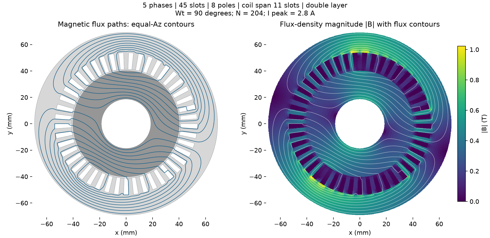
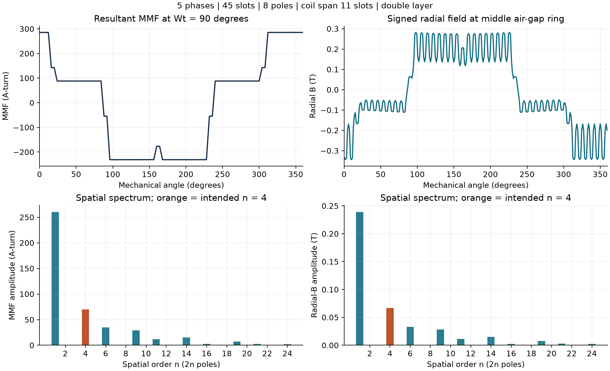

# Dolomites / Koil
# Winding generation and multiphase field studies

> A detailed logical account of the implemented algorithm, followed by three reproducible winding, MMF and magnetic-field studies.

**LAGHA Khalil Ellah**

13 November 2026

Application, integration and numerical visualisation: LAGHA Khalil Ellah.
Upstream winding generation: Luigi Alberti and the Dolomites contributors, through the Koil module.

[GitHub project - Winding and flux analysis program](https://github.com/KhalilEllahLAGHA/Winding-and-flux-analysis-program)

[Author's GitHub](https://github.com/KhalilEllahLAGHA)

[Portfolio project, figures and two flux videos](https://khalilellahlagha.github.io/projects/winding-flux-analysis.html)

## Reading order

**Part I** explains the algorithm symbolically, without a numerical example: input checks; electrical star; signed phase sectors; physical coils; matrix validation; MMF; polar reluctance network; flux density and animation.

**Part II** applies the full calculation to the normal three-phase default, a two-phase winding and the requested five-phase, 45-slot, 8-pole, span-11 winding. Each case includes its phase/resultant MMF and its flux-path/density figure.

**Part III** explains the five-phase rotating-field deformation, the limits of an efficiency interpretation, reproduction and source credits.

> The figures are computed from the application's winding matrix and magnetic solver. The videos recombine signed solved fields; they are not a rotated picture of one field snapshot.

<!-- pagebreak -->

# Part I - Algorithm, without an example

## 1. Define the inputs and conventions

The generator takes a slot count Q, an even total pole count P, a phase count m, a coil span y in slots, and a single- or double-layer choice. A phase is a separate winding circuit; a signed conductor represents the reference orientation of one of its coil sides. Positive and negative signs do not prescribe the instantaneous direction of a sinusoidal current.

| Quantity | Definition | Role |
| --- | --- | --- |
| Q | Integer slot count, at least 2 | Number of matrix columns |
| P, p | Total poles P; pole pairs p=P/2 | Mechanical-to-electrical angle conversion |
| m | Phase count, 1 to 26 in this interface | Phase sectors and matrix row count |
| y | Integer coil span, 1 to Q | Distance from coil start to return |
| N, I_peak | Turn multiplier and peak-current setting | Excitation amplitude |
| φ=Wt | Electrical excitation angle | Time position within the sinusoidal cycle |

The app keeps total poles in the interface and converts to pole pairs only for Dolomites. Its default span is the integer part of the pole pitch, bounded below by one slot. If single layer is selected, an even requested span is reduced by one to obtain an odd throw. The resulting value is displayed in the controls.

## 2. Establish the logical calculation chain

```text
Inputs and dimensional checks
  -> periodicity and initial feasibility
  -> electrical star of slot vectors
  -> signed phase sectors
  -> physical coil start/return pairs
  -> connection matrix and final balance checks
  -> phase currents and tooth/slot MMF
  -> polar mesh, reluctances and impressed MMF sources
  -> magnetic potential solve and branch fluxes
  -> flux-density maps, equal-Az contours and animation
```

The first six operations define the winding. The remaining operations use that same winding as the source of the magnetic calculation. The drawing is derived from the matrix, avoiding a separate visual assignment that could disagree with the numerical model.

The implemented winding source is the pinned Dolomites Koil module [1]. Its star and coil-population logic are retained. The application's adapter corrects periodic sector membership and adds explicit physical and phase-balance validation.

<!-- pagebreak -->

# Electrical star and initial feasibility

## 3. Check machine periodicity

Let t be the greatest common divisor of Q and p. It describes repetition in the electrical slot star. Define h as the number of distinct spokes per phase:

```math
t=\gcd(Q,p),\qquad h=\frac{Q}{m t},\qquad q=\frac{Q}{m P}.
```

Dolomites requires h to be an integer. When m is even, h must also be even. For single layer, Q must be even. These checks are preliminary: the selected throw must still produce complete, balanced physical coils. The slots-per-pole-per-phase quantity q can be fractional; a fractional q alone does not make a winding invalid.

## 4. Construct one electrical vector for each slot

The electrical angle between adjacent physical slots is α_se. The spacing of distinct star directions is α_star. A common reference offset ε is applied before assigning sectors:

```math
\alpha_{se}=\frac{2\pi p}{Q},\qquad \alpha_{star}=\frac{2\pi t}{Q},\qquad
\theta_s=((s-1)\alpha_{se}+\varepsilon)\bmod 2\pi.
```

The slot index s is one-based. Each vector keeps that original physical slot number. Several slots may have the same electrical direction; they remain distinct physical slots. No mechanical slot is moved. The offset ε sets the reference placement of the star relative to the phase sectors; it is not a rotor displacement or the excitation angle φ.

Koil selects ε with these exact rules, after the initial feasibility check:

| Phase-count parity | Condition | Reference offset ε |
| --- | --- | --- |
| Odd m | h=1 or h=2 | π/(2m) |
| Odd m | h>2 and h even | α_star/2 |
| Odd m | h>2 and h odd | α_star/4 |
| Even m | h=2 | 0 |
| Even m | h>2 and h/2 even | α_star/4 |
| Even m | h>2 and h/2 odd | α_star/2 |

All calculations use radians internally. Angles are wrapped to a full electrical revolution. This construction encodes the slot/pole relationship before coil connections or current amplitudes are introduced.

<!-- pagebreak -->

# Phase sectors and physical coils

## 5. Create the signed phase sectors

For zero-based phase index k, Koil uses these phase offsets and positive-sector centres:

```math
\delta_k^{odd}=\frac{2\pi k}{m},\qquad \delta_k^{even}=\frac{\pi k}{m},
\qquad \gamma_k=\frac{\pi}{2}+\delta_k.
```

Each positive sector has width π/m and is centred on γ_k. Its negative sector is shifted by π. This is Dolomites' even-phase convention; other machine winding topologies may use another phase arrangement. The current offsets used later match the generated winding axes.

For each slot vector, the adapter computes its modular distance from each sector's lower boundary. A sector includes its lower boundary and excludes its upper boundary. Values numerically close to a full turn or zero are snapped to zero using a 1e-10 radian tolerance. This periodic half-open rule assigns a boundary spoke once and handles sectors that cross the angular origin. It repairs omissions caused by the upstream Python strict comparisons.

## 6. Connect the coil start to its return

Sector membership gives a phase k and a reference sign σ, positive or negative. The return position is found with circular slot indexing:

```math
r(s)=((s-1+y)\bmod Q)+1.
```

The coil starts with sign σ in slot s and returns with sign -σ in slot r(s), in the same phase. The return is not independently reassigned from the sector at its destination. This preserves the physical coil connection when a shortened or extended throw puts its return beside another phase's start.

- **Double layer:** every slot starts a coil in the top layer; its return is placed in the bottom layer. The total number of coils is Q.
- **Single layer:** only odd one-based slots start coils. The odd span places their returns in even slots. The total number of coils is Q/2 when the layout passes the final checks.

## 7. Store the physical connection matrix

The matrix C has Q columns. Single layer has m rows, one for each phase. Double layer has 2m rows: all top phase rows, followed by all bottom phase rows. For each coil, add σ at its start and subtract σ at its return, in the appropriate phase/layer row. New upstream coils use a unit signed conductor count. Entries are 0, +1 or -1 for the accepted layouts.

Explicit phase-count and layer metadata accompany C. A row count alone is insufficient: it can represent different phase/layer combinations. The same matrix supplies conductor colours/polarities in the drawing and the winding sources used in MMF and field calculations.

<!-- pagebreak -->

# Final validation and winding factors

## 8. Validate the assembled winding

The adapter first checks slot occupancy: the sum of absolute matrix entries in each slot must be one for single layer and two for double layer. Define the complete phase matrix W as C for single layer, or the sum of corresponding top and bottom rows for double layer.

Each complete phase row must sum to zero, so its signed coil sides have a balanced return. The total absolute conductor count must be equal and nonzero in every phase. This checks actual populated coils, rather than relying only on the initial integer conditions.

The working-harmonic phasor of phase k is then:

```math
z_k=\sum_{s=1}^{Q}W_{ks}\exp\left(-j\frac{2\pi p(s-1)}{Q}\right).
```

Unless W cancels identically, each z_k must be nonzero and its ratio to the first phase must agree with the required phase axis:

```math
\frac{z_k}{z_0}=\exp(-j\delta_k).
```

The implementation checks this numerically with absolute and relative tolerances of 1e-8. An identically cancelled W is accepted as a zero-excitation layout. A feasible flag therefore identifies a structurally valid winding, not an optimised machine or a guarantee of a strong useful field.

## 9. Evaluate the working-harmonic winding factor

Let c_k be the absolute conductor count of complete phase k. For double layer this is the sum of abs(C_top) and abs(C_bottom) over slots, counting both physical coil sides even where their signed contributions cancel. The factor for the prescribed working pole count is the average normalised conductor phasor magnitude:

```math
k_w=\frac{1}{m}\sum_{k=0}^{m-1}\frac{|z_k|}{c_k},\qquad
k_p=\left|\sin\left(\frac{\pi P y}{2Q}\right)\right|.
```

The electrical coil span is β=2πpy/Q. The pitch factor uses half of this span: k_p=abs(sin(β/2)). Where k_p is nonzero, the distribution factor is k_d=k_w/k_p. The model has no skew, so k_s=1. For a fully cancelling pitch, the distribution of coil starts is evaluated separately and k_w is zero.

These factors describe coupling to the selected working spatial harmonic. A small k_w can coexist with strong components at other pole counts. To understand field quality, the study also examines the spatial MMF and air-gap flux-density spectra.

Valid generated matrices are cached by slots, poles, layers, effective span and phase count. Callers receive a copy, so changing a drawing or calculation cannot alter the cached winding.

<!-- pagebreak -->

# From the winding to its MMF

## 10. Apply the phase currents

The instantaneous current in phase k is sinusoidal, using the same δ_k as the phase-sector construction:

```math
i_k(\varphi)=I_{peak}\sin(\varphi+\delta_k).
```

The use of sine in this app and the default cosine convention in upstream Koil differ by a common time-origin shift. The current setting is a peak value. N is the application's coil-side turn multiplier; it is not automatically the number of series turns in the entire phase.

The app's excitation bookkeeping gives these signed slot ampere-turns:

```math
NI_s^{single}=N\sum_k C_{ks}i_k,\qquad
NI_s^{double}=\frac{N}{2}\sum_k W_{ks}i_k.
```

**Model convention:** double-layer calculations split the configured current equally across layers. This is the convention implemented in this application, not a universal rule that every physical double-layer coil carries half the phase current. Its values must be interpreted with the actual series/parallel connections when applying the model to a manufactured machine.

## 11. Integrate the slot excitation around the teeth

The total signed slot NI must sum to zero. The algorithm integrates these jumps around the circumference, then subtracts the mean to fix the arbitrary MMF reference:

```math
F_{s+1}-F_s=NI_s,\qquad \sum_s F_s=0.
```

Tooth s immediately precedes slot s. The resulting winding function is constant over a tooth and varies linearly across the following slot to the next tooth value. Exact tooth/slot breakpoints and closure at a complete mechanical revolution are included in the plotted profile.

The engine first calculates phase winding functions independent of φ. Their sinusoidal factors are applied and summed to obtain the instantaneous resultant. Consequently, a phase can have a nonzero reference winding function while its instantaneous contribution vanishes at a current zero crossing.

For separate top/bottom plots, any nonzero mean in an individual layer is removed; the removed means cancel in the complete phase. The field solve uses the complete physical winding excitation. Cached phase functions make changes of φ and MMF animation inexpensive without changing the selected winding.

<!-- pagebreak -->

# Polar mesh and magnetic-network solve

## 12. Construct the machine mesh and reluctances

The cross-section contains rotor iron, air gap, alternating stator teeth/slots and stator yoke. Radial bands are subdivided and combined with periodic angular divisions. The default slot opening is half the slot pitch. Fractional default angles retain precision; equal slot/tooth arcs use a stable mesh base. Excessive requested meshes are rejected before allocation.

For a polar cell with inner/outer radii a,b, centre c=(a+b)/2, angular width Δθ, axial length L and permeability μ=μ0 μ_r, the half-cell reluctances are:

```math
R_{up}=\frac{\ln(b/c)}{\mu L\Delta\theta},\quad
R_{down}=\frac{\ln(c/a)}{\mu L\Delta\theta},\quad
R_{left}=R_{right}=\frac{\Delta\theta}{2\mu L\ln(b/a)}.
```

All lengths in these equations are metres and angles are radians. A branch between neighbouring cell centres contains both adjacent half-cell reluctances. Its conductance is the reciprocal of their sum. Angular neighbours wrap around the circumference; the shaft and outer boundaries have zero normal flux.

## 13. Map the winding MMF into physical source cells

In the slot/tooth source band, F(θ) is distributed through its radial thickness. For source-band bounds R_i,R_o, the radial half-cell source weights are:

```math
w_{up}=\frac{b^2-c^2}{R_o^2-R_i^2},\quad
w_{down}=\frac{c^2-a^2}{R_o^2-R_i^2},\quad
f_{up}=-F(\theta)w_{up},\quad f_{down}=-F(\theta)w_{down}.
```

The radial signs follow the solver's positive-radial source convention. Circumferential impressed MMF is zero. Other material bands contain no winding source. This distributes the actual tooth/slot winding function rather than applying one arbitrary concentrated source to every layer.

## 14. Solve the magnetic-potential system

Each cell enforces flux continuity. For conductances g_ij, the sparse matrix has diagonal sum(g_ij) and off-diagonal -g_ij. The right-hand side contains the signed divergence of source-driven branch flux. One potential is fixed as a reference because only differences are physical.

The app uses cached sparse LU for up to 100,000 cells, with checked PCG fallback. Excitation changes reuse the network and factorisation; geometry/material changes rebuild them. Acceptance requires the full-network residual to satisfy max(10 times the requested tolerance, 1e-12). This tests algebraic solution quality. Mesh convergence, permeability realism and agreement with measurements remain separate accuracy questions.

<!-- pagebreak -->

# Flux density, contours and animation

## 15. Recover the physical field

Branch fluxes follow from magnetic-potential differences and the signed impressed MMF. With outward face-flux conventions, cell-centre components are reconstructed as:

```math
B_r=\frac{\Phi_{up}-\Phi_{down}}{2c\Delta\theta L},\quad
B_\theta=\frac{\Phi_{right}-\Phi_{left}}{2cL\ln(b/a)},\quad
|B|=\sqrt{B_r^2+B_\theta^2}.
```

The density map colours the magnitude in tesla. A conservative planar vector potential A_z is reconstructed from the shared face fluxes. Equal-A_z contours show magnetic flux paths. With ψ=L A_z, angular differences in ψ give radial face flux and negative radial differences give circumferential face flux. Therefore adjacent contour levels carry equal planar flux L ΔA_z [3].

Equal contour spacing applies within each frame. The plotting routine recalculates the contour interval from that frame's potential range; the interval is not held fixed through the video. Contour counts are therefore not an equal-flux comparison between figures or frames. The density colour scale is held fixed over a case's full cycle, but differs between cases; read its numerical values when comparing fields.

## 16. Generate continuous animation from two signed solutions

Geometry, prescribed permeability and winding connections are fixed. Since the model is linear and all currents have a common sinusoidal excitation angle, the field at an arbitrary φ is obtained from the solved signed fields at zero and a quarter electrical cycle:

```math
\mathbf{B}(\varphi)=\mathbf{B}(0)\cos\varphi+
\mathbf{B}(\pi/2)\sin\varphi.
```

A_z uses the same superposition. Magnitude is calculated after the signed components are combined. Interpolating magnitude maps instead would discard field direction and give an incorrect result. The two-basis method also preserves simultaneous spatial harmonics; it does not assume the entire field rotates rigidly.

Preparation runs in a cancellable background worker. Playback updates magnitude and contours with fixed cycle limits and elapsed-time timing. The full signed excitation period is one electrical revolution; magnitude and undirected contour patterns repeat after half a revolution.

## 17. Interpret the model's scope

This is a two-dimensional, fixed-permeability magnetostatic sequence on a stationary machine geometry. It calculates field distributions and winding harmonic content. Saturation, rotor motion, induced rotor currents, conductor resistance, iron-loss laws, shaft power and thermal behaviour are not modelled. The videos slow an electrical excitation sweep for inspection; their playback speed is not a simulated mechanical rotor speed. A visually distorted rotating field can diagnose undesirable spatial components, but requires an appropriate torque/loss model before efficiency can be quantified.

<!-- pagebreak -->

# Part II - Shared study conditions

All three studies use the implemented double-layer winding and the same prescribed material, excitation and radial dimensions. Slot count, slot opening, poles, phase count and throw vary as specified. This is a winding/field demonstration, not an equal-power or equal-copper experiment.

| Parameter | Value |
| --- | --- |
| Stator outer / inner radius | 69.15 / 41.25 mm |
| Rotor outer / shaft radius | 40.25 / 18.65 mm |
| Air gap / slot height | 1.00 / 12.60 mm |
| Active axial length | 110 mm |
| Prescribed iron / air relative permeability | 4000 / 1 |
| Configured N / peak phase current | 204 / 2.8 A |
| Effective peak current per layer, app convention | 1.4 A |
| Slot opening | Half the slot pitch: 180°/Q |
| Static excitation angle | φ=90° electrical |
| Mesh | Medium: 10 radial cells per band; angular divider 3 |
| Solver request | Automatic method; tolerance 1e-8 |

## How to read the case figures

The MMF figure shows each phase's instantaneous contribution and their resultant versus mechanical position. Its vertical unit is ampere-turn. At the chosen static angle a phase at a current zero crossing can have a flat zero contribution; this does not mean that phase has no coils.

The field figure places equal-A_z flux contours beside the magnitude map with superimposed contours. Axes are millimetres; the colour scale is tesla. The visible stationary slot geometry helps reveal local field modulation. The fixed-permeability values, including local peaks approaching or exceeding practical iron saturation ranges, are linear-model predictions and do not include saturation feedback.

Spectral results use mechanical spatial order n: an n-order wave has 2n poles. The designed working order is p=P/2. The MMF spectrum is sampled at 16,384 uniform positions. Air-gap radial B is sampled at the centres of the inner mesh ring nearest the gap midpoint, radius 40.7 mm. Snapshot coefficients describe φ=90°; two-basis coefficients also distinguish travelling directions. Finite angular resolution limits the resolved field spectrum.

Each case was checked against a separate full solve at φ=37°. This checks the animation superposition independently of the plotted static angle. Full-cycle magnitude maxima are evaluated analytically from the two signed bases. No new FEMM run is claimed for these three studies.

<!-- pagebreak -->

# Case 1 - Normal three-phase default

## Inputs and logical calculation

| Phases m | Slots Q | Total poles P | Span y | Layers |
| --- | --- | --- | --- | --- |
| 3 | 36 | 4 | 9 | Double |

The pole-pair count is p=2. The periodicity is t=gcd(36,2)=2, h=36/(3×2)=6 and q=36/(3×4)=3. The adjacent electrical slot angle is 20°. Koil's offset is ε=10°, so the star begins at 10°, 30°, 50° and continues in 20° steps with repeated electrical directions. Phase offsets are 0°, 120° and 240°.

The signed start-sector sequence over slots 1-18 is B−, A+, C−, B+, A−, C+, with three successive slots in each group; it repeats over slots 19-36. Span 9 places the return 180° electrical from its start. A start in slot 4 returns in slot 13 with the same phase and opposite polarity.

The matrix has 6 rows and 36 columns. There are 36 coils, 12 per phase, and 24 signed coil sides per complete phase. Slot occupancy and phase-axis checks pass. The full-pitch factor is k_p=1, the distribution factor is k_d=0.959795 and k_w=0.959795.


The working MMF wave has a peak spatial coefficient of **1568.58 A-turn**. The resultant retains a dominant four-pole shape, with smaller winding harmonics and slot transitions. Its amplitude follows the app's documented double-layer current convention.

<!-- pagebreak -->

# Case 1 - Flux paths and density



The medium mesh contains **8,640 cells**, with 216 angular divisions and 40 radial divisions. The two field-basis solves have full-network relative residuals below 8e-15. The independent 37° full-solve comparison differs from the two-basis field by less than 1.6e-12 T at the cell centres.

The intended four-pole structure is visible in the flux paths. Slot openings and finite teeth locally modify the otherwise dominant working wave. At the 40.7 mm sample radius, the n=2 radial-B component has peak amplitude **1.43877 T** at the static angle. The largest field magnitude anywhere over the full electrical cycle is **2.94584 T** in this prescribed-permeability model.

The strong working component and k_w near unity show that the conductor arrangement uses the configured ampere-turns effectively for its intended four-pole MMF. This statement concerns winding coupling. It is not an efficiency percentage, and the linear iron model does not reduce high local peaks through saturation.

[Watch the default-setting flux video in the portfolio](https://khalilellahlagha.github.io/projects/winding-flux-analysis.html#flux-videos)

<!-- pagebreak -->

# Case 2 - Two-phase winding

## Inputs and logical calculation

| Phases m | Slots Q | Total poles P | Span y | Layers |
| --- | --- | --- | --- | --- |
| 2 | 24 | 4 | 6 | Double |

This case keeps the four-pole working field and uses a slot count compatible with the even-phase Dolomites rule. Here p=2, t=2 and h=24/(2×2)=6. Because h is even, it passes the additional even-phase condition. The slots-per-pole-per-phase value remains q=3.

Adjacent slots are 30° electrical apart. Since h/2 is odd, Koil uses ε=α_star/2=15°. The phase offsets are **0° and 90°**, following the 180°/m even-phase convention. The positive sectors are 90° wide and their negative sectors are diametrically opposite.

Span 6 is 180° electrical, giving full-pitch coils. A coil starting in slot 1 returns in slot 7, preserving its phase and reversing its reference sign. The resulting 4×24 matrix defines 24 coils, 12 per phase, and 24 complete coil sides per phase. The final balance checks pass. The factors are k_p=1 and k_d=k_w=0.910684.


The working n=2 MMF coefficient is **990.64 A-turn peak** at this snapshot. Two quadrature phase currents still produce a travelling working wave over the cycle; the static zero crossing of one phase is not evidence of an absent rotating field.

<!-- pagebreak -->

# Case 2 - Flux paths and density



The mesh contains **5,760 cells**, with 144 angular divisions and 40 radial divisions. Both full-network basis residuals are below 7.2e-15. The independent 37° field comparison agrees within 1.1e-12 T at the cell centres.

The magnetic paths retain the prescribed four-pole working structure. The sampled near-midgap-ring n=2 radial-B coefficient is **0.85541 T peak**, while the largest magnitude over the full electrical cycle is **1.93337 T**. These field values use exactly the same N and current settings as the first case, but the phase count, number of slots/coils and angular geometry differ.

The k_w of 0.910684 quantifies the working-harmonic reduction from its actual conductor distribution. A lower working field than the three-phase example cannot by itself establish lower efficiency: neither equal shaft output nor equal copper volume has been enforced, and no losses have been calculated.

The even-phase treatment is carried through the whole calculation. Using a fixed three-phase 120° current sequence with this matrix would represent a different excitation and would give an incorrect interpretation. The application instead carries m=2 explicitly from the winding generator into the MMF and field calculations.

<!-- pagebreak -->

# Case 3 - Five phases, long coil span

## Requested inputs and logical calculation

| Phases m | Slots Q | Total poles P | Span y | Layers |
| --- | --- | --- | --- | --- |
| 5 | 45 | 8 | 11 | Double |

The requested settings are used exactly, without shortening the throw. Here p=4, t=gcd(45,4)=1, h=45/(5×1)=9 and q=45/(5×8)=9/8. This fractional-slot double-layer winding passes the initial rules. Koil uses ε=2°. Adjacent slots are 32° electrical apart; the five phase offsets are 0°, 72°, 144°, 216° and 288°.

The matrix is 10×45, with 45 coils, 9 per phase, and 18 complete coil sides per phase. A coil start in slot 1 returns in slot 12; a start in slot 40 wraps to slot 6. All five working phasor magnitudes match and their axes differ by 72°. The winding and excitation are therefore **phase-balanced**.

The long throw spans 11×32°=**352° electrical**. Its oppositely signed coil sides are almost a full electrical revolution apart, so they nearly cancel at the intended eight-pole order. The pitch factor is abs(sin(352°/2))=**0.0697565**. Although k_d=0.983831, the resulting working winding factor is only **k_w=0.0686286**.



The intended n=4 MMF coefficient is **69.96 A-turn peak**. A lower spatial order n=1, corresponding to two poles, reaches **260.42 A-turn peak** - approximately **3.72 times** the intended component. Phase balance alone does not suppress this parasitic spatial component.

<!-- pagebreak -->

# Case 3 - Flux paths and density



The mesh contains **10,800 cells**, with 270 angular divisions and 40 radial divisions. The basis residuals are below 2.6e-14. The independent 37° check agrees with the field superposition within 3.4e-13 T at the cell centres. Small algebraic residuals confirm the network solve; they do not remove the model's material or mesh limitations.

At the 40.7 mm sample radius, the n=1 radial-B coefficient is **0.239151 T peak**, versus **0.066927 T** for the intended n=4 component. The two-pole contribution is approximately **3.57 times** the eight-pole contribution. The maximum field magnitude anywhere over the full electrical cycle is **1.02272 T**.

The broad flux paths in the figure agree with this spectral diagnosis. The selected pole count identifies the intended working harmonic; it does not force the solved field to contain only that harmonic. Actual signed conductors and phase currents determine all spatial components present.

Across the excitation sweep, the dominant n=1 wave and the n=4 working wave travel in opposite directions and at different mechanical angular rates. Their sum changes shape rather than behaving as one rigidly rotating eight-pole pattern. This explains the visibly irregular or asymmetric rotation in the requested video while remaining consistent with balanced phase currents.

[Watch the exact five-phase flux video in the portfolio](https://khalilellahlagha.github.io/projects/winding-flux-analysis.html#flux-videos)

<!-- pagebreak -->

# Part III - Why the field deforms



## Distinguish a balanced supply from a clean spatial field

Balance checks concern equal phase conductor counts, equal working-phasor magnitudes and the correct phase offsets. They do not prove that the resultant winding function is sinusoidal. The requested layout satisfies balance while producing a strong lower spatial order. Calling it a phase-unbalanced winding would identify the wrong cause.

A travelling component of order n can be written as A cos(nθ±φ+γ). Its phase moves at a mechanical angular rate with magnitude electrical angular rate divided by n. The two-basis Fourier decomposition separates these directions: in this plot's positive-θ convention, the n=1 component travels toward positive θ and the working n=4 component toward negative θ. The former has four times the mechanical angular-speed magnitude of the latter. Their interference, together with other spatial components and slot modulation, explains the changing field shape.

## Comment on useful coupling and possible efficiency consequences

This particular span-11 arrangement makes poor use of its configured ampere-turns for intended eight-pole operation: k_w is only 0.0686 and the two-pole field dominates. Parasitic spatial components can contribute to torque pulsations and additional rotor/iron losses in a real machine [4]. Their effect depends on the rotor, its speed, conductivity, materials and operating point.

**The report therefore diagnoses poor working-harmonic coupling and distorted rotation, not a calculated efficiency loss.** It does not imply that five-phase machines are inherently less efficient. A torque, resistance, induced-current and loss model - or suitable measurements - is required to establish efficiency for a physical machine.

<!-- pagebreak -->

# Comparison and numerical evidence

| Quantity | Three-phase default | Two-phase | Five-phase requested |
| --- | --- | --- | --- |
| m / Q / P / y | 3 / 36 / 4 / 9 | 2 / 24 / 4 / 6 | 5 / 45 / 8 / 11 |
| Electrical coil span | 180° | 180° | 352° |
| Working k_w | 0.959795 | 0.910684 | 0.068629 |
| Intended spatial order | n=2 | n=2 | n=4 |
| Working MMF peak, A-turn | 1568.58 | 990.64 | 69.96 |
| Working gap Br peak, T | 1.43877 | 0.85541 | 0.06693 |
| Mesh cells | 8,640 | 5,760 | 10,800 |

These amplitudes are obtained under common app N/current settings, not common useful power. Their comparison isolates the implemented layouts and shows why a nominal pole count alone cannot characterise the generated field. The five-phase distribution factor is high, but its nearly full-electrical-period throw sharply suppresses the intended working component.

## What the videos demonstrate

The default video and the exact five-phase video use actual signed field and A_z basis solutions. Their density limits remain fixed within each recording. The excitation makes one full electrical sweep; playback is slowed for inspection and the stationary rotor geometry is retained. They demonstrate field shape and spatial wave interaction, rather than shaft motion or an electromagnetic transient with eddy currents.

The two-basis model is also checked numerically. At an independently solved angle, the maximum cell-centre discrepancy is about 1e-12 T or less. The full-network residuals are far below the acceptance threshold. These are consistency checks; the newly studied cases have not received a separate mesh-convergence or FEMM accuracy certification.

The cell-centre magnetic-energy diagnostic is essentially constant over each cycle, with relative peak-to-peak differences around 1e-15. Consequently, the changing five-phase picture should not be described as calculated energy instability or an efficiency ripple. Shape deformation and energy dissipation are different quantities.

## Engineering follow-up

For a practical eight-pole design, coil throw should be revisited while preserving phase symmetry, physical occupancy and manufacturability. The relevant comparison would include working harmonic, parasitic orders, copper length/resistance, rotor loss, saturation and torque. The requested span-11 case is preserved in the report and video as a diagnostic study; no favourable replacement has been substituted.

<!-- pagebreak -->

# Reproduction, authorship and credits

## Reproduce the figures and videos

From a source checkout, install the main and optional publication dependencies, generate the numerical assets, then render this report:

```text
python -m pip install -r requirements.txt -r requirements-report.txt
python tools/generate_report_assets.py
python tools/build_algorithm_report.py
```

The authored source is `docs/multiphase-report/report.md`. The same folder contains its rendered PDF, scientific PNGs and MP4s under `assets/`, plus machine-readable JSON/CSV evidence under `data/`. The matrix CSVs, MMF samples, air-gap samples, mesh settings, winding factors, residuals and independent animation checks identify how each figure was obtained. The source generator sets the case parameters explicitly, including the requested five-phase span 11.

The application uses PyQt6 with a neutral dark interface, multiphase controls, cached numerical solutions and continuous field animation. Its implementation is available in the [GitHub project](https://github.com/KhalilEllahLAGHA/Winding-and-flux-analysis-program). This report and both flux recordings are also linked from the [portfolio project](https://khalilellahlagha.github.io/projects/winding-flux-analysis.html).

## Attribution

**LAGHA Khalil Ellah** is credited for this application, the integration, report and numerical visualisation. **Luigi Alberti and the Dolomites contributors** are credited for the upstream Koil winding generator and its published method. The generator source is copied unmodified at pinned revision `21eceabcdf09ecd0873b693cfa123b3567d6f62b`; adapter changes and checks are identified in `core/connection_matrix.py` and the third-party notice. Dolomites copyright is 2006-2026 L. Alberti and contributors, University of Padova. Its GPLv3 licence and notice are retained under `third_party/dolomites/` and bundled with the executable. AI assistance supported implementation, analysis and report preparation; the numerical evidence and stated model assumptions remain explicit.

## References

[1] Dolomites / Koil, upstream Python project and pinned source. [Project repository](https://gitlab.com/LuigiAlberti/dolomites-python). [Pinned README and contributor/licence information](https://gitlab.com/LuigiAlberti/dolomites-python/-/raw/21eceabcdf09ecd0873b693cfa123b3567d6f62b/README.md).

[2] L. Alberti, **Koil: A Tool to Design the Winding of Rotating Electric Machinery**, 2018 XIII International Conference on Electrical Machines (ICEM), Alexandroupoli, Greece, pp. 805-811. [DOI: 10.1109/ICELMACH.2018.8507004](https://doi.org/10.1109/ICELMACH.2018.8507004). [University of Padova publication record](https://www.research.unipd.it/handle/11577/3296310). The implementation account here is verified against the pinned source; the article is credited as its methodological reference.

[3] D. Meeker, **Finite Element Method Magnetics - User's Manual**, section 2.3.6, flux contours and magnetic vector potential. [Official FEMM manual](https://www.femm.info/Archives/doc/manual.pdf).

[4] B. Brkovic and M. Jecmenica, **Calculation of Rotor Harmonic Losses in Multiphase Induction Machines**, Machines 2022, 10(5), 401. [DOI: 10.3390/machines10050401](https://doi.org/10.3390/machines10050401). This source supports the qualitative harmonic-loss mechanism; its machine-specific loss values are not transferred to the present model.
