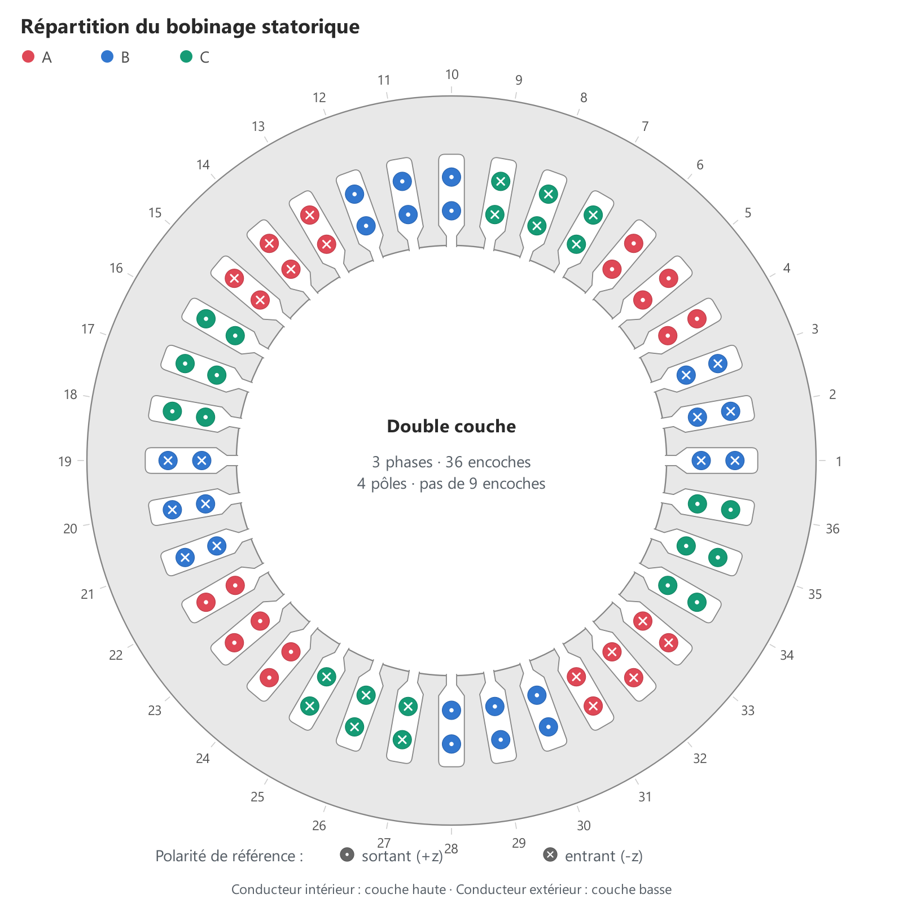
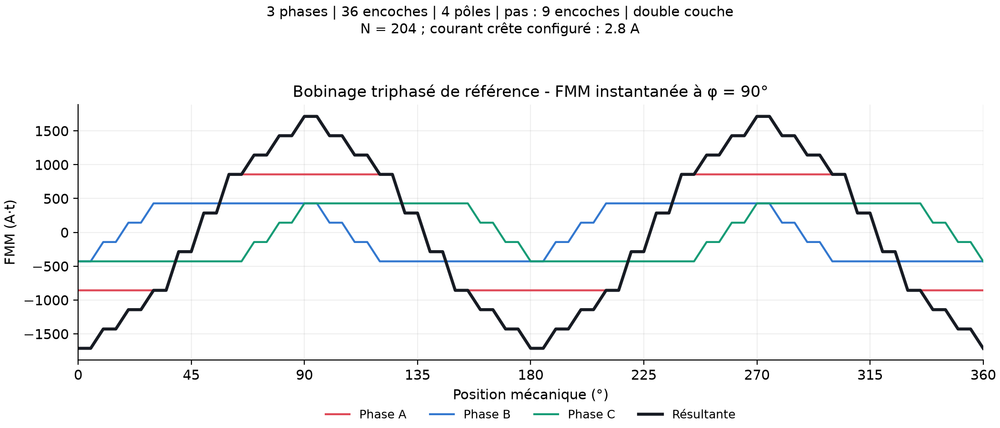
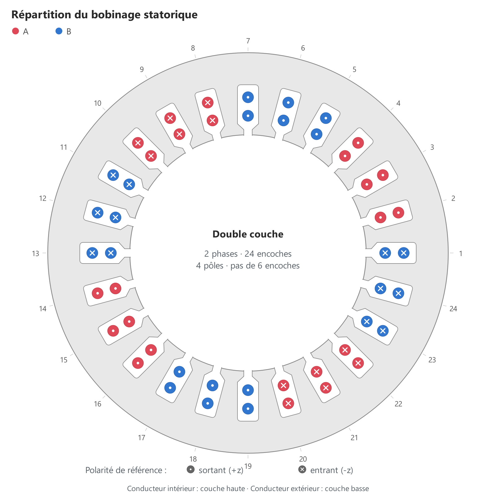
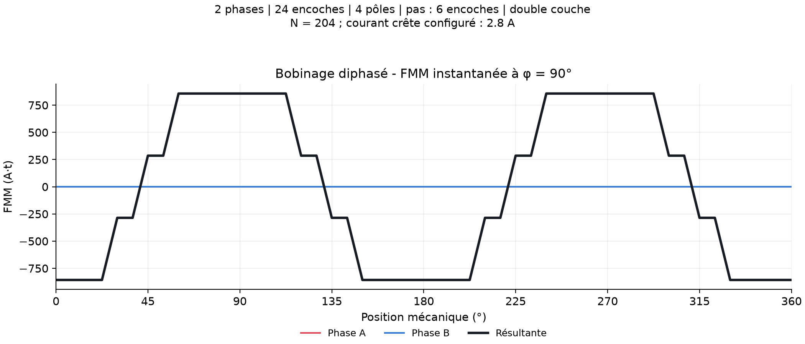
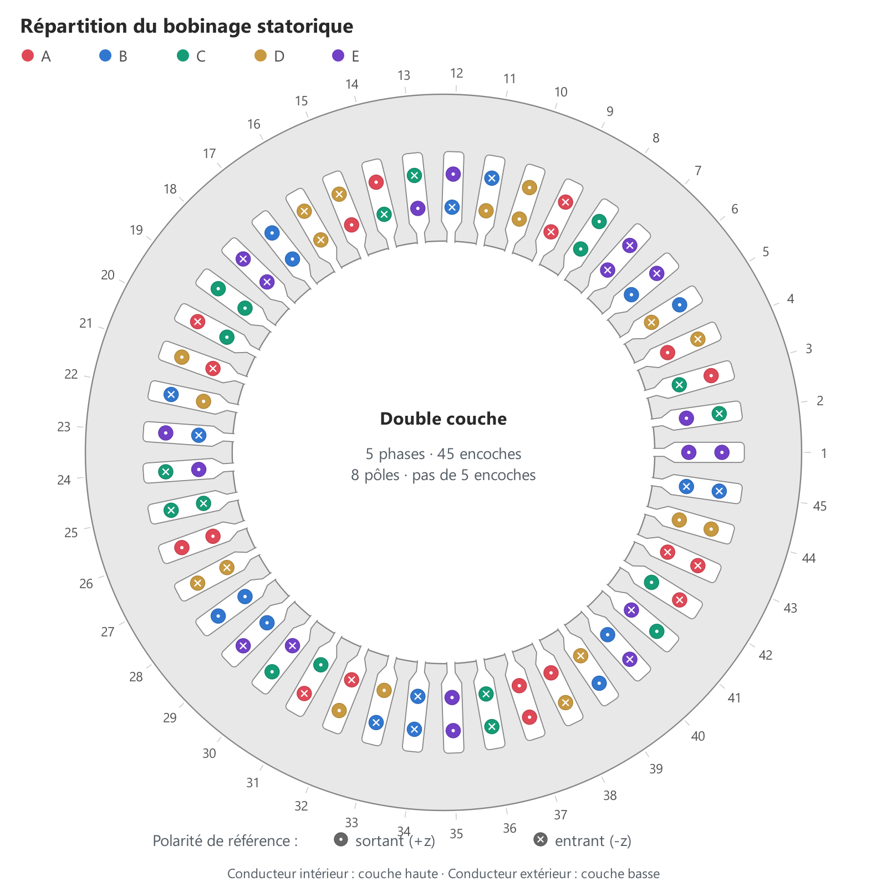
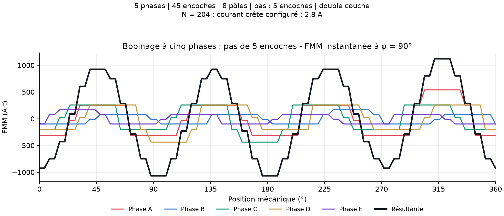
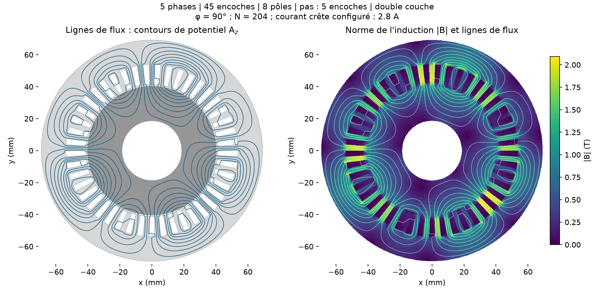
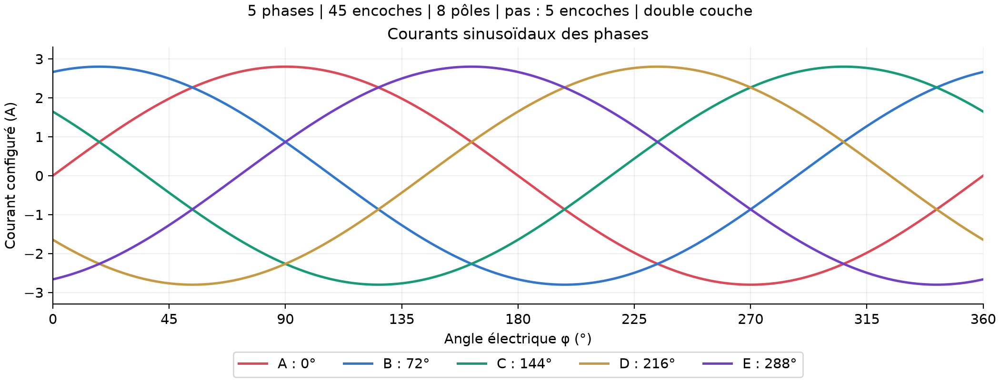
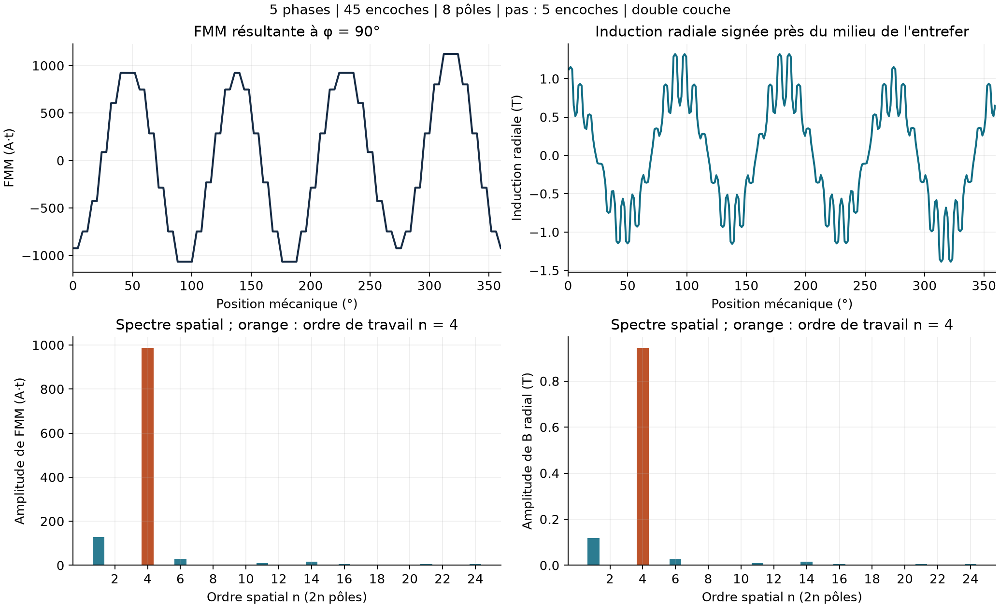

# Bobinages multiphasés
# Génération algorithmique et analyse du champ magnétique

> Rapport de méthode et études numériques : connexions du bobinage, force magnétomotrice, réseau de réluctances et visualisation du champ.

**Réalisé par LAGHA Khalil Ellah**

Révision du 14 novembre 2026

## Résumé

J'ai développé une application permettant de construire un bobinage multiphasé, de calculer sa force magnétomotrice et d'étudier le champ magnétique obtenu dans une section de machine électrique. J'ai intégré une méthode de l'étoile des encoches issue des références [1, 2], puis relié les connexions physiques à un modèle magnétique bidimensionnel par réseau de réluctances.

Ce rapport présente d'abord les algorithmes sous forme d'entrées, de sorties, d'étapes de calcul et de contrôles, sans exemple numérique. J'applique ensuite la démarche à trois configurations : un bobinage triphasé, un bobinage diphasé et un bobinage pentaphasé à 45 encoches, 8 pôles et un pas de 5 encoches. Chaque étude comprend la répartition du bobinage statorique, la FMM, les lignes de flux et l'induction magnétique.

L'analyse distingue le nombre de phases électriques, le nombre de pôles recherché et les composantes spatiales présentes dans le champ. Le cas pentaphasé étudié présente un couplage élevé avec son ordre de travail à huit pôles, tout en conservant des composantes parasites résiduelles. Cette conclusion est établie à partir des connexions, des courants et du spectre spatial.

## Organisation

- **Partie I :** formulation générale et huit algorithmes de calcul, sans exemple.
- **Partie II :** application détaillée aux trois configurations et figures associées.
- **Partie III :** contrôle des cinq phases, analyse harmonique et synthèse.
- **Références :** sources de la méthode et du générateur intégré.

[Code source de l'application](https://github.com/KhalilEllahLAGHA/Winding-and-flux-analysis-program)

[Présentation du projet et vidéos du champ](https://khalilellahlagha.github.io/projects/winding-flux-analysis.html#flux-videos)

<!-- pagebreak -->

# Partie I - Formulation générale

## Objectif et notations

L'objectif est de transformer des paramètres géométriques et électriques en une distribution spatiale de conducteurs, puis en une distribution d'induction magnétique. Je conserve une seule matrice de connexions pour le dessin, la FMM et l'excitation du modèle magnétique, afin de garantir leur cohérence.

| Symbole | Définition | Unité ou domaine |
| --- | --- | --- |
| Q | Nombre total d'encoches | Entier positif |
| P, p | Nombre total de pôles ; p=P/2 paires de pôles | P pair |
| m | Nombre de phases électriques | Entier positif |
| y | Pas entre départ et retour d'une bobine | Encoches |
| C, W | Matrice physique ; matrice complète par phase | Coefficients signés |
| N | Multiplicateur de spires des côtés de bobine | Sans dimension |
| I_crête, φ | Amplitude du courant ; angle électrique | A ; rad |
| F, Φ, B | FMM ; flux ; induction magnétique | A·tour ; Wb ; T |

Une phase désigne un circuit électrique alimenté par un courant déterminé. Un pôle décrit la structure spatiale du champ. Un harmonique spatial d'ordre mécanique n possède 2n pôles. L'ordre de travail recherché est p. Ces grandeurs restent distinctes pendant toute la chaîne de calcul.

## Chaîne fonctionnelle

```text
Paramètres du bobinage
  -> validation et périodicité
  -> étoile des encoches et secteurs de phase
  -> connexions des départs et des retours
  -> matrice physique et contrôles d'équilibrage
  -> courants et force magnétomotrice spatiale
  -> maillage et réluctances élémentaires
  -> potentiels magnétiques et flux de branche
  -> induction, lignes de flux et animation
```

Les algorithmes décrivent l'implémentation utilisée. Le modèle magnétique suppose des perméabilités imposées et une géométrie fixe. Il permet l'étude du champ et de ses composantes spatiales. Le rendement demande des modèles complémentaires de pertes et de puissance mécanique.

<!-- pagebreak -->

# Algorithme 1 - Valider les paramètres

## Entrées, sorties et étapes

**Entrées :** Q, P, m, pas y demandé et nombre de couches. **Sorties :** paramètres normalisés, p, périodicité t, indicateurs h et q, ou motif de rejet.

```text
1. Vérifier que Q, P, m et y sont des entiers admissibles.
2. Exiger Q >= 2, P >= 2 et P pair.
3. Dans l'interface, limiter m à l'intervalle [1, 26].
4. Exiger 1 <= y <= Q ; déterminer le pas par défaut si nécessaire.
5. En simple couche, remplacer un pas pair par y - 1.
6. Calculer p = P/2 et t = PGCD(Q, p).
7. Calculer h = Q/(m*t) et q = Q/(m*P).
8. Rejeter la configuration si h n'est pas entier.
9. Si m est pair, exiger également que h soit pair.
10. En simple couche, exiger Q pair.
11. Transmettre les paramètres validés à l'algorithme suivant.
```

Le nombre de pôles affiché dans l'interface est P. La conversion en paires de pôles est effectuée pour les calculs électriques. Si aucun pas n'est fourni, je prends la partie entière du pas polaire, avec une borne minimale d'une encoche.

## Sens des conditions

```math
p=\frac{P}{2},\qquad t=\gcd(Q,p),\qquad
h=\frac{Q}{mt},\qquad q=\frac{Q}{mP}.
```

La périodicité t traduit la répétition des directions électriques dans l'étoile. Le nombre de directions distinctes est Q/t ; h exprime leur répartition par phase. Les conditions sur h proviennent de la méthode intégrée [1].

Le quotient q représente le nombre d'encoches par pôle et par phase. Il peut être fractionnaire : une valeur non entière n'entraîne pas, à elle seule, le rejet du bobinage.

Ces conditions sont préliminaires. Elles ne garantissent pas que le pas choisi remplit correctement les encoches ou produit un harmonique de travail utile. Les connexions réellement assemblées sont contrôlées ensuite. Une configuration incompatible est signalée explicitement ; le nombre de couches n'est pas modifié silencieusement.

<!-- pagebreak -->

# Algorithme 2 - Construire l'étoile

## Entrées et sorties

**Entrées :** Q, p, m et t. **Sortie :** direction électrique et secteur de phase signé de chaque encoche physique s.

Je distingue l'écart électrique entre encoches successives, α_se, et l'écart entre directions distinctes, α_étoile :

```math
\alpha_{se}=\frac{2\pi p}{Q},\qquad \alpha_{etoile}=\frac{2\pi t}{Q},\qquad
\theta_s=((s-1)\alpha_{se}+\varepsilon)\bmod 2\pi.
```

Le décalage ε positionne l'étoile relativement aux frontières des secteurs. Il s'agit d'une référence électrique, et non d'un déplacement du rotor. Les règles sont les suivantes [1] :

| Parité de m | Condition | Valeur de ε |
| --- | --- | --- |
| Impair | h=1 ou h=2 | π/(2m) |
| Impair | h>2 et h pair | α_étoile/2 |
| Impair | h>2 et h impair | α_étoile/4 |
| Pair | h=2 | 0 |
| Pair | h>2 et h/2 pair | α_étoile/4 |
| Pair | h>2 et h/2 impair | α_étoile/2 |

## Construction et affectation des secteurs

Pour la phase k, comptée à partir de zéro, le secteur positif est centré en γ_k ; son secteur négatif est décalé de π. Chaque secteur possède une largeur π/m.

```math
\delta_k^{impair}=\frac{2\pi k}{m},\qquad
\delta_k^{pair}=\frac{\pi k}{m},\qquad
\gamma_k=\frac{\pi}{2}+\delta_k.
```

```text
1. Déterminer epsilon avec le tableau.
2. Pour chaque s, calculer theta_s et le ramener modulo 2*pi.
3. Construire les secteurs positif et négatif de chaque phase.
4. Calculer la distance périodique depuis leur borne inférieure.
5. Inclure la borne inférieure et exclure la borne supérieure.
6. Affecter à s une phase k et un signe de référence sigma.
```

Cette règle semi-ouverte évite les doubles affectations et traite les secteurs traversant l'origine. Une tolérance de 1e-10 rad traite les valeurs proches de zéro ou d'un tour complet. Les vecteurs conservent leurs numéros physiques, même lorsque plusieurs encoches partagent une direction électrique.

<!-- pagebreak -->

# Algorithme 3 - Former les bobines

## Entrées et sorties

**Entrées :** affectations des encoches, pas y et nombre de couches. **Sorties :** liste des bobines et matrice physique signée C.

Une bobine appartient à une phase unique. Si son départ est en s avec le signe σ, son retour est en r(s) avec le signe opposé. Le retour conserve la phase du départ ; son affectation n'est pas recalculée indépendamment à partir de son propre secteur.

```math
r(s)=((s-1+y)\bmod Q)+1.
```

## Étapes de connexion

```text
1. Initialiser C à zéro, avec Q colonnes.
2. Prévoir m lignes en simple couche, 2*m en double couche.
3. Parcourir les encoches de départ affectées aux phases.
4. En simple couche, conserver seulement les départs impairs.
5. Calculer le retour r(s) avec bouclage périodique.
6. Ajouter sigma au départ dans la ligne de sa phase.
7. Soustraire sigma au retour de la même phase.
8. En double couche, placer les retours dans les lignes du bas.
9. Conserver explicitement m et les couches avec la matrice.
```

| Type | Lignes de C | Occupation physique |
| --- | --- | --- |
| Simple couche | Une ligne par phase | Un côté de bobine par encoche |
| Double couche | Phases du haut, puis phases du bas | Deux côtés par encoche |

Les coefficients +1 et -1 donnent une orientation de référence. Le courant instantané est appliqué ultérieurement. Zéro indique l'absence de conducteur pour la phase et la couche considérées.

En double couche, chaque encoche fournit un départ et reçoit un retour : le nombre total de bobines est Q. En simple couche, les départs impairs et le pas impair placent les retours dans les encoches paires ; un bobinage complet contient Q/2 bobines.

Je préserve les signes physiques des deux couches sans les normaliser séparément. Le dessin des conducteurs est déduit de cette même matrice. Le nombre de lignes ne sert pas seul à inférer le nombre de phases : les métadonnées explicites évitent toute confusion entre différentes associations de phases et de couches.

<!-- pagebreak -->

# Algorithme 4 - Contrôler le bobinage

## Entrées, sorties et étapes

**Entrées :** C, m, p et couches. **Sorties :** décision de validité et facteurs du bobinage à l'ordre de travail.

La matrice complète W vaut C en simple couche, ou la somme des lignes correspondantes du haut et du bas en double couche. Le nombre c_k de côtés de la phase k est calculé en additionnant leurs valeurs absolues dans les deux couches, avant compensation des signes.

```text
1. Vérifier l'occupation de chaque encoche : 1 ou 2 côtés.
2. Former la matrice complète W par phase.
3. Vérifier que chaque ligne de W possède une somme nulle.
4. Vérifier des nombres de conducteurs égaux et non nuls par phase.
5. Calculer le vecteur complexe z_k à l'ordre de travail p.
6. Vérifier amplitude et déphasage relativement à la phase 0.
7. Rejeter une construction incomplète ou déséquilibrée.
8. Calculer les facteurs de pas, de distribution et de bobinage.
```

## Axes de phase et facteurs

```math
z_k=\sum_{s=1}^{Q}W_{ks}\exp\left(-j\frac{2\pi p(s-1)}{Q}\right),\qquad
\frac{z_k}{z_0}=\exp(-j\delta_k).
```

La dernière relation vérifie l'égalité des amplitudes et l'écartement des axes, avec des tolérances absolue et relative de 1e-8. Si W est identiquement nulle, la construction est conservée comme cas d'excitation nulle. Sinon, un vecteur de travail nul est rejeté.

```math
k_w=\frac{1}{m}\sum_{k=0}^{m-1}\frac{|z_k|}{c_k},\qquad
\beta=\frac{2\pi p y}{Q},\qquad
k_p=\left|\sin\left(\frac{\beta}{2}\right)\right|.
```

Le facteur de distribution est k_d=k_w/k_p lorsque k_p est non nul. Le modèle est sans inclinaison des encoches : le facteur d'inclinaison est un. En cas de compensation complète du pas, la distribution des départs est évaluée séparément et k_w est nul.

Ces facteurs caractérisent le couplage avec l'ordre de travail p. L'équilibrage des phases ne garantit pas une FMM sinusoïdale pure. Je complète donc ce contrôle par le spectre spatial de la FMM et de l'induction dans l'entrefer.

<!-- pagebreak -->

# Algorithme 5 - Calculer la FMM

## Entrées et sorties

**Entrées :** matrice physique, N, amplitude du courant et angle φ. **Sorties :** ampères-tours par encoche, FMM par phase et résultante.

Les courants utilisent les déphasages δ_k des axes de bobinage :

```math
i_k(\varphi)=I_{crete}\sin(\varphi+\delta_k).
```

N représente le multiplicateur de spires des côtés de bobine utilisé par le modèle, et non automatiquement le total des spires en série d'une phase. En double couche, j'utilise la convention de partage du courant configuré entre les deux couches :

```math
NI_s^{simple}=N\sum_k C_{ks}i_k,\qquad
NI_s^{double}=\frac{N}{2}\sum_k W_{ks}i_k.
```

Cette division par deux est une convention d'excitation de l'application. Pour une machine construite, elle doit être rapprochée des connexions série/parallèle réelles ; elle n'est pas une propriété générale des bobinages à deux couches.

## Étapes d'intégration spatiale

```text
1. Calculer le courant instantané de chaque phase.
2. Pondérer les conducteurs signés par les courants et par N.
3. Former le total NI_s dans chaque encoche.
4. Vérifier que la somme des NI_s sur un tour est nulle.
5. Intégrer les sauts de FMM d'une dent à la suivante.
6. Retirer la moyenne pour fixer la référence de FMM.
7. Interpoler sur les régions de dent et d'encoche.
8. Additionner les contributions des phases.
```

```math
F_{s+1}-F_s=NI_s,\qquad \sum_s F_s=0.
```

La FMM est constante dans une dent et varie linéairement dans l'encoche suivante jusqu'à la dent voisine. La fermeture périodique est imposée sur un tour mécanique. Les transitions sont incluses explicitement dans les profils, pour conserver les paliers et leurs bonnes positions.

Je mémorise les fonctions spatiales de phase indépendantes de φ. Un nouvel angle modifie leurs pondérations sinusoïdales, sans reconstruire le bobinage. Une contribution peut être nulle à un passage par zéro du courant, tout en participant au champ à d'autres instants.

<!-- pagebreak -->

# Algorithme 6 - Construire le réseau

## Entrées, sorties et étapes

**Entrées :** dimensions, matériaux, longueur active et réglages de maillage. **Sorties :** cellules polaires, voisinages, réluctances et sources distribuées.

Je subdivise la section en rotor, entrefer, bande des dents et encoches, puis culasse. Les divisions radiales sont croisées avec des divisions angulaires périodiques. Les matériaux sont affectés selon la position physique des cellules.

```text
1. Vérifier l'emboîtement des rayons et la place de la culasse.
2. Calculer le pas d'encoche et les ouvertures angulaires.
3. Choisir les divisions aux limites des matériaux.
4. Subdiviser chaque bande radiale.
5. Former les cellules et attribuer les matériaux.
6. Relier les voisins, avec bouclage angulaire.
7. Calculer les demi-réluctances entre centre et faces.
8. Introduire la FMM dans les cellules de la bande source.
```

Pour une cellule de rayons a et b, de centre c=(a+b)/2, de largeur Δθ, de longueur L et de perméabilité μ=μ0 μ_r :

```math
R_{haut}=\frac{\ln(b/c)}{\mu L\Delta\theta},\quad
R_{bas}=\frac{\ln(c/a)}{\mu L\Delta\theta},\quad
R_{gauche}=R_{droite}=\frac{\Delta\theta}{2\mu L\ln(b/a)}.
```

Les longueurs de ces équations sont en mètres et les angles en radians. Une branche entre deux centres comporte la somme des demi-réluctances voisines. Les limites intérieure et extérieure imposent un flux normal nul.

## Répartition des sources

Dans la bande source de bornes radiales R_i et R_o, les poids appliqués à la FMM F(θ) sont :

```math
w_{haut}=\frac{b^2-c^2}{R_o^2-R_i^2},\quad
w_{bas}=\frac{c^2-a^2}{R_o^2-R_i^2},\quad
f_{haut}=-F(\theta)w_{haut},\quad f_{bas}=-F(\theta)w_{bas}.
```

Les signes suivent la convention radiale du solveur. Les sources circonférentielles sont nulles. Hors de la bande source, aucune FMM imposée n'est ajoutée. Dans les encoches, je conserve la même interpolation spatiale que dans le calcul de FMM.

<!-- pagebreak -->

# Algorithme 7 - Résoudre le champ

## Entrées et sorties

**Entrées :** réluctances et sources de FMM. **Sorties :** potentiels magnétiques, flux de branche et composantes de l'induction.

La conservation du flux dans chaque cellule conduit à un système linéaire creux. Je note g_ij l'inverse de la somme des demi-réluctances d'une branche i-j. Une référence est fixée puisque le potentiel u est défini à une constante près.

```math
A u=b,\qquad A_{ii}=\sum_j g_{ij},\qquad A_{ij}=-g_{ij}.
```

Le second membre b contient les contributions signées des sources imposées. La structure et la factorisation de A sont conservées lorsque seule l'excitation change. Une modification de géométrie, de matériau ou de longueur entraîne leur reconstruction.

```text
1. Calculer les conductances des branches.
2. Assembler les diagonales et les couplages de A.
3. Former b à partir de la divergence signée des sources de flux.
4. Fixer une référence de potentiel.
5. Résoudre par factorisation creuse LU lorsque cela est adapté.
6. Utiliser un gradient conjugué préconditionné en solution de repli.
7. Contrôler le résidu sur le réseau complet.
8. Reconstituer les flux à partir des potentiels et FMM de branche.
9. Convertir les flux en composantes d'induction.
```

La résolution directe mise en cache est privilégiée jusqu'à 100 000 cellules. Le résidu relatif complet doit être inférieur au maximum de dix fois la tolérance demandée et 1e-12. Ce contrôle est algébrique ; il ne mesure pas l'erreur de discrétisation ou l'erreur du modèle physique.

## Reconstruction de l'induction

Avec les flux sortants sur les faces de cellule :

```math
B_r=\frac{\Phi_{haut}-\Phi_{bas}}{2c\Delta\theta L},\qquad
B_\theta=\frac{\Phi_{droite}-\Phi_{gauche}}{2cL\ln(b/a)},\qquad
|B|=\sqrt{B_r^2+B_\theta^2}.
```

L'induction est exprimée en teslas. La carte de couleur représente sa norme. Les composantes signées sont conservées pour les comparaisons, l'analyse harmonique et l'animation.

<!-- pagebreak -->

# Algorithme 8 - Visualiser et animer

## Lignes de flux

**Entrées :** flux partagés entre cellules. **Sortie :** potentiel vecteur plan A_z et lignes de flux.

Je reconstruis A_z à partir des flux du réseau. Avec ψ=L A_z, une différence angulaire de ψ donne le flux radial et une différence radiale opposée donne le flux circonférentiel. Les courbes de niveau de A_z représentent les lignes de flux [3].

```text
1. Reconstituer les flux communs aux faces voisines.
2. Ajuster le potentiel vecteur avec les conditions périodiques.
3. Choisir des niveaux de A_z régulièrement espacés.
4. Tracer les contours et superposer la norme de B.
```

Dans une image, deux niveaux consécutifs représentent le même incrément de flux L ΔA_z. L'intervalle est recalculé selon l'étendue du potentiel de chaque image. Le nombre de lignes ne sert donc pas à comparer directement les flux entre images ou configurations.

## Animation par deux solutions signées

À géométrie et perméabilités fixes, le modèle est linéaire. Pour une excitation sinusoïdale multiphasée :

```math
\mathbf{B}(\varphi)=\mathbf{B}(0)\cos\varphi+
\mathbf{B}(\pi/2)\sin\varphi.
```

L'identité sin(φ+δ)=sin(δ)cos(φ)+cos(δ)sin(φ) regroupe les contributions de toutes les phases dans deux coefficients temporels. **Deux solutions de référence ne signifient pas deux phases d'alimentation.** Les m phases sont toutes prises en compte dans les deux résolutions de référence.

```text
1. Résoudre à phi=0, avec toutes les phases.
2. Résoudre à phi=pi/2, avec toutes les phases.
3. Combiner B et A_z signés à l'angle voulu.
4. Calculer ensuite la norme et les contours.
5. Actualiser les courants de phase et l'angle affichés.
6. Conserver l'échelle d'induction pendant le cycle d'un cas.
```

La superposition s'applique avant le calcul de la norme. La vidéo montre un balayage électrique ralenti dans une géométrie fixe ; elle ne simule pas la dynamique mécanique du rotor.

<!-- pagebreak -->

# Partie II - Conditions des études

J'ai fixé les dimensions radiales, la longueur active, les perméabilités et les réglages d'excitation. Les nombres d'encoches, de phases et de pôles, ainsi que le pas de bobine et l'ouverture des encoches, sont précisés pour chaque étude.

| Paramètre commun | Valeur |
| --- | --- |
| Rayon extérieur / intérieur du stator | 69,15 / 41,25 mm |
| Rayon extérieur du rotor / rayon de l'arbre | 40,25 / 18,65 mm |
| Entrefer / hauteur d'encoche | 1,00 / 12,60 mm |
| Longueur active | 110 mm |
| Perméabilité relative du fer / de l'air | 4000 / 1 |
| Multiplicateur N / courant de crête configuré | 204 / 2,8 A |
| Courant de crête par couche, convention du modèle | 1,4 A |
| Ouverture angulaire d'encoche | Demi-pas : 180°/Q |
| Angle des figures statiques | φ=90° électriques |
| Maillage | 10 subdivisions radiales par bande ; diviseur angulaire 3 |
| Tolérance demandée | 1e-8 |

## Lecture et vérification

Les figures de FMM donnent les contributions instantanées par phase et leur somme. Les cartes associent les lignes de flux à la norme de l'induction. Les sections sont repérées en millimètres et les échelles d'induction en teslas.

La FMM est échantillonnée en 16 384 positions mécaniques. L'induction radiale est relevée sur l'anneau le plus proche du milieu de l'entrefer, ici à 40,7 mm ; le milieu géométrique est à 40,75 mm. Les amplitudes spectrales sont des amplitudes de crête. Un ordre mécanique n correspond à 2n pôles.

J'ai comparé la superposition à une résolution complète indépendante à φ=37°. Les maxima sur le cycle sont déduits des deux champs signés. Les résultats et les contrôles présentés correspondent à la révision du 14 novembre 2026.

Il s'agit de distributions de champ sous des réglages communs, sans dimensionnement à puissance utile ou volume de cuivre identiques. Les perméabilités étant imposées, les valeurs locales élevées d'induction ne prennent pas en compte la saturation.

<!-- pagebreak -->

# Étude 1 - Répartition statorique

## Trois phases, 36 encoches, 4 pôles, pas de 9



Cette représentation utilise le même dessin de stator que la présentation du projet. Chaque encoche comporte deux côtés de bobine. La couleur identifie la phase A, B ou C ; le point et la croix indiquent les orientations de référence sortante et entrante.

Le conducteur le plus proche de l'alésage représente la couche haute ; le second représente la couche basse. Les liaisons frontales ne sont pas dessinées dans cette coupe : leur association est définie par le pas de neuf encoches et la matrice physique.

<!-- pagebreak -->

# Étude 1 - Construction et FMM

## Paramètres et déroulement

| Phases m | Encoches Q | Pôles P | Pas y | Couches |
| --- | --- | --- | --- | --- |
| 3 | 36 | 4 | 9 | Double |

**Étape 1 - Validation.** p=2, t=PGCD(36,2)=2, h=36/(3×2)=6 et q=36/(3×4)=3. Les conditions initiales sont satisfaites.

**Étape 2 - Étoile.** L'écart électrique entre encoches est de 20° et ε=10°. Les premières directions sont 10°, 30°, 50°, puis les suivantes par pas de 20°. Les phases sont espacées de 120°.

**Étape 3 - Connexions.** Sur les encoches 1 à 18, les secteurs de départ suivent B−, A+, C−, B+, A−, C+, avec trois encoches par groupe. La séquence se répète. Le pas de neuf encoches correspond à 180° électriques ; un départ en encoche 4 revient en encoche 13 avec le signe opposé.

**Étape 4 - Contrôles.** La matrice 6×36 décrit 36 bobines, soit 12 par phase et 24 côtés par phase complète. Les facteurs valent k_p=1 et k_d=k_w=0,959795.



J'observe une résultante dominée par l'ordre de travail, d'amplitude spectrale de crête **1568,58 A·tour**. Les paliers et transitions reflètent la répartition discrète des conducteurs et l'interpolation dans les encoches.

<!-- pagebreak -->

# Étude 1 - Flux et induction


## Résultats numériques

Le maillage comprend **8 640 cellules**, avec 216 divisions angulaires et 40 radiales. Les résidus relatifs complets sont inférieurs à 8e-15. L'écart avec la résolution indépendante à 37° reste inférieur à 1,6e-12 T aux centres des cellules.

La composante radiale d'ordre n=2 dans l'entrefer atteint **1,43877 T** de crête. La norme maximale sur la section et le cycle vaut **2,94584 T** dans le modèle à perméabilités imposées.

## Interprétation

Les lignes de flux présentent la structure à quatre pôles. Les ouvertures d'encoche et les dents modulent localement le champ. Le facteur de bobinage proche de l'unité traduit un couplage élevé avec l'ordre spatial recherché.

Les pointes locales d'induction restent des prédictions du modèle linéaire. Leur évaluation dans une machine réelle demanderait une loi de matériau non linéaire.

La vidéo représente le même calcul pendant un cycle électrique. Les courants A, B et C sont affichés avec le champ pour relier l'excitation temporelle à sa distribution spatiale.

[Vidéo de la configuration triphasée](https://khalilellahlagha.github.io/projects/winding-flux-analysis.html#flux-videos)

<!-- pagebreak -->

# Étude 2 - Répartition statorique

## Deux phases, 24 encoches, 4 pôles, pas de 6



Les deux couleurs identifient les deux circuits électriques. Les signes portés par les conducteurs sont des références géométriques ; les courants instantanés en quadrature sont appliqués ensuite.

Les deux positions radiales d'une encoche représentent les couches haute et basse. Le retour d'une bobine est situé six encoches après son départ et conserve sa phase avec le signe opposé. Les couleurs et les signes du dessin sont vérifiés contre la matrice 4×24.

<!-- pagebreak -->

# Étude 2 - Construction et FMM

## Paramètres et déroulement

| Phases m | Encoches Q | Pôles P | Pas y | Couches |
| --- | --- | --- | --- | --- |
| 2 | 24 | 4 | 6 | Double |

**Étape 1 - Validation.** Pour p=2, j'obtiens t=2, h=24/(2×2)=6 et q=3. Le nombre de phases est pair et la condition supplémentaire h pair est satisfaite.

**Étape 2 - Étoile.** L'écart électrique est de 30°. Comme h/2 est impair, ε=15°. Les déphasages sont **0° et 90°**, selon la convention retenue pour un nombre pair de phases.

**Étape 3 - Connexions.** Le pas de six encoches représente 180° électriques. Un départ en encoche 1 revient en encoche 7, dans la même phase et avec le signe opposé.

**Étape 4 - Contrôles.** La matrice 4×24 contient 24 bobines, soit 12 bobines et 24 côtés par phase. Les facteurs sont k_p=1 et k_d=k_w=0,910684.



La composante de travail n=2 atteint **990,64 A·tour** de crête. La résultante se superpose ici à A. Sur le cycle, B varie en quadrature et participe au champ tournant : une image instantanée ne suffit pas à déterminer le nombre de phases d'alimentation.

<!-- pagebreak -->

# Étude 2 - Flux et induction


## Résultats numériques

Le maillage comporte **5 760 cellules**, avec 144 divisions angulaires et 40 radiales. Les résidus relatifs complets sont inférieurs à 7,2e-15. L'écart avec la résolution indépendante à 37° est inférieur à 1,1e-12 T.

Sur l'anneau proche du milieu de l'entrefer, la composante radiale de travail n=2 atteint **0,85541 T** de crête. La norme maximale sur la section et le cycle vaut **1,93337 T**.

## Interprétation

Le champ conserve la structure de travail à quatre pôles. La quadrature des courants diphasés permet sa composante tournante. Le facteur de distribution 0,910684 correspond à l'atténuation produite par les positions réelles des conducteurs.

Les amplitudes diffèrent de celles du cas triphasé malgré des valeurs de N et de courant identiques. Les nombres de phases et de bobines diffèrent également. J'interprète donc ces résultats comme une comparaison de distributions de champ, et non comme un classement de rendement.

Le traitement des phases est explicite : les deux courants de cette étude sont en quadrature ; aucun déphasage triphasé fixe n'est appliqué à cette matrice.

<!-- pagebreak -->

# Étude 3 - Répartition statorique

## Cinq phases, 45 encoches, 8 pôles, pas de 5



Le dessin conserve exactement les 45 encoches, les 8 pôles de travail et le pas de 5. Il est produit par le composant natif de l'application, avec des annotations en français. La matrice représentée est comparée à celle du générateur avant l'export.

Les cinq couleurs repèrent les phases, et non les pôles. Le décalage entre les conducteurs des couches haute et basse est imposé par les retours de bobine à cinq encoches du départ. Les polarités indiquées restent des orientations de référence indépendantes de l'instant d'excitation.

<!-- pagebreak -->

# Étude 3 - Construction et FMM

## Paramètres et déroulement

| Phases m | Encoches Q | Pôles P | Pas y | Couches |
| --- | --- | --- | --- | --- |
| 5 | 45 | 8 | 5 | Double |

**Étape 1 - Validation.** p=4, t=PGCD(45,4)=1, h=9 et q=9/8. Le bobinage fractionnaire à deux couches satisfait les conditions initiales.

**Étape 2 - Étoile.** L'écart électrique entre encoches est de 32° et ε=2°. Les déphasages sont **0°, 72°, 144°, 216° et 288°**.

**Étape 3 - Connexions.** Le départ 1 revient en encoche 6 ; le départ 40 revient en encoche 45. La matrice **10×45** décrit 45 bobines : neuf bobines et 18 côtés par phase complète.

**Étape 4 - Facteurs.** Le pas de cinq encoches représente **160° électriques**. Ainsi, k_p=abs(sin(80°))=**0,9848078**. Avec k_d=0,983831, le facteur de travail atteint **k_w=0,9688848**. Les cinq axes de phase sont équilibrés à l'ordre n=4.



Le pas est proche du pas polaire de 45/8=5,625 encoches. Son ouverture électrique est proche de 180°, ce qui explique le facteur de pas élevé. La FMM de travail atteint **987,69 A·tour** de crête ; les composantes d'autres ordres sont analysées séparément.

<!-- pagebreak -->

# Étude 3 - Flux et induction



## Résultats numériques

Le maillage comprend **10 800 cellules**, avec 270 divisions angulaires et 40 radiales. Les résidus relatifs complets sont inférieurs à 1,1e-14. La superposition est comparée à une résolution indépendante à 37° avec un écart inférieur à **1,3e-12 T**.

Dans l'entrefer, la composante radiale de travail n=4 atteint **0,944865 T**, contre **0,117748 T** pour n=1. La composante à deux pôles représente ainsi environ **12,46 %** de l'amplitude de travail. La norme maximale sur la section et le cycle vaut **2,09136 T**.

## Lecture physique

Le pas de cinq encoches produit un couplage élevé avec les huit pôles recherchés. Les lignes de flux et le spectre montrent cette composante dominante. Les conducteurs discrets et les ouvertures d'encoche conservent néanmoins d'autres composantes spatiales.

Le nombre de phases est vérifié dans la matrice et les courants, indépendamment de la forme instantanée du champ. La page suivante détaille cette vérification pentaphasée.

[Vidéo des cinq courants et du champ pentaphasé](https://khalilellahlagha.github.io/projects/winding-flux-analysis.html#flux-videos)

<!-- pagebreak -->

# Vérification des cinq phases

## Excitation effectivement utilisée

Les cinq courants configurés, d'amplitude 2,8 A, sont :

```math
i_k(\varphi)=2.8\sin\left(\varphi+\frac{2\pi k}{5}\right),\qquad k=0,1,2,3,4.
```



À φ=90°, les valeurs de A à E sont respectivement **2,8000 ; 0,8652 ; -2,2652 ; -2,2652 ; 0,8652 A**. La convention double couche divise ces valeurs par deux dans chaque couche. Les cinq phases sont présentes même lorsque deux valeurs instantanées coïncident par symétrie.

## Contrôles de cohérence

```text
1. Lire m=5 et vérifier les 10 lignes physiques de C.
2. Vérifier les déphasages et les conducteurs de chaque phase.
3. Calculer séparément les cinq contributions de FMM.
4. Vérifier que leur somme donne la FMM résultante.
5. Résoudre séparément les excitations de phase au même angle.
6. Vérifier que la somme des champs signés donne le champ total.
```

Les cinq phases définissent l'alimentation. Les deux solutions temporelles sont une décomposition du calcul linéaire. La vidéo présente simultanément les cinq courants, leurs valeurs et l'angle électrique avec le champ à huit pôles dominant.

À 37°, la somme des cinq champs résolus séparément reproduit le champ total avec un écart maximal inférieur à **1,1e-12 T**. Les cinq contributions de champ sont non nulles à cet angle.

<!-- pagebreak -->

# Partie III - Analyse harmonique



## Composante utile et composantes résiduelles

La FMM de travail n=4 atteint **987,69 A·tour**, tandis que n=1 atteint **128,22 A·tour**, soit environ **13,0 %** de l'amplitude utile. Le spectre confirme la dominance de l'ordre à huit pôles et le facteur de bobinage élevé de cette configuration.

Une onde spatiale s'écrit A cos(nθ±φ+γ). La vitesse mécanique de phase a pour module la vitesse électrique divisée par n. La décomposition des champs distingue les deux sens : dans le repère des figures, n=1 se propage vers les θ croissants et n=4 vers les θ décroissants. Le premier possède un module de vitesse de phase quatre fois plus élevé.

La superposition de la composante utile dominante et des composantes résiduelles peut légèrement modifier la forme du champ pendant le cycle. Les encoches ajoutent des modulations locales. Ces effets ne constituent pas un déséquilibre des cinq courants.

## Conséquences pour la conception

Le pas de cinq exploite efficacement les ampères-tours pour l'ordre de travail à huit pôles, au sens du facteur de bobinage. Les composantes parasites peuvent toutefois contribuer aux ondulations de couple et à des pertes supplémentaires dans le rotor ou le fer [4]. Leur effet réel dépend du rotor, de la vitesse et des matériaux.

Le modèle ne calcule pas ces pertes ni la puissance mécanique. Il fournit un diagnostic du champ, sans valeur numérique de rendement et sans conclusion générale défavorable aux machines à cinq phases.

<!-- pagebreak -->

# Synthèse et limites de l'étude

| Grandeur | Triphasé | Diphasé | Pentaphasé |
| --- | --- | --- | --- |
| m / Q / P / y | 3 / 36 / 4 / 9 | 2 / 24 / 4 / 6 | 5 / 45 / 8 / 5 |
| Ouverture électrique de bobine | 180° | 180° | 160° |
| Facteur de travail k_w | 0,959795 | 0,910684 | 0,968885 |
| Ordre de travail | n=2 | n=2 | n=4 |
| FMM de travail de crête, A·tour | 1568,58 | 990,64 | 987,69 |
| Induction radiale de travail de crête, T | 1,43877 | 0,85541 | 0,94486 |
| Cellules | 8 640 | 5 760 | 10 800 |

## Bilan

J'ai relié les connexions physiques à une chaîne complète : courants de phase, FMM, sources distribuées, réluctances, flux et induction. Les contrôles géométriques, électriques et algébriques vérifient la cohérence des étapes.

Les trois études présentent un couplage élevé à leur ordre de travail. Le cas pentaphasé au pas de cinq conserve une composante utile à huit pôles dominante et des composantes parasites résiduelles. Les dessins statoriques permettent de relier directement ces résultats aux phases et aux côtés de bobine de chaque configuration.

## Limites et prolongements

Les calculs sont bidimensionnels, à géométrie fixe et perméabilités imposées. Ils n'incluent ni saturation, ni courants induits dans le rotor, ni résistance des conducteurs, ni pertes fer, ni dynamique mécanique. Le résidu vérifie le réseau ; la précision physique demande une étude de convergence et une validation adaptée.

Les cas ne sont pas dimensionnés à puissance ou masse de cuivre égales. Leurs amplitudes ne classent donc pas leurs rendements. Le diagnostic d'énergie à partir des valeurs centrales de B reste pratiquement constant sur le cycle : la déformation du champ pentaphasé ne constitue pas une perte d'énergie mesurée.

Pour prolonger ce travail, je comparerais les pas en conservant remplissage et équilibrage, puis j'introduirais saturation, couple et pertes. Il deviendrait possible d'évaluer les compromis entre ordre de travail, composantes parasites, longueur de cuivre et performances réelles.

<!-- pagebreak -->

# Reproductibilité et références

## Organisation des résultats

Le [dépôt de l'application](https://github.com/KhalilEllahLAGHA/Winding-and-flux-analysis-program) contient les algorithmes, les paramètres et les exports numériques. Matrices, profils de FMM, échantillons d'induction et indicateurs de résolution sont conservés avec les figures. La [présentation du projet](https://khalilellahlagha.github.io/projects/winding-flux-analysis.html#flux-videos) donne accès aux deux vidéos.

Les études et le rapport peuvent être reproduits avec les scripts fournis :

```text
python -m pip install -r requirements.txt -r requirements-report.txt
python tools/generate_report_assets.py
python tools/build_algorithm_report.py
```

J'ai développé l'application et intégré la génération des connexions au calcul de FMM et à la visualisation du champ. Les sources de la méthode et du générateur sont créditées ci-dessous.

## Références et crédits

**[1] Dolomites / Koil.** Projet Python de Luigi Alberti et des contributeurs, Université de Padoue. Le module Koil fournit l'étoile des encoches et la population des bobines intégrées à cette application. Révision utilisée : `21eceabcdf09ecd0873b693cfa123b3567d6f62b`. Le code amont, sa notice et sa licence GNU GPLv3 sont conservés dans le dépôt. Mon adaptateur corrige les appartenances périodiques aux frontières des secteurs et ajoute les contrôles physiques présentés. [Dépôt du projet](https://gitlab.com/LuigiAlberti/dolomites-python). [Notice de la révision](https://gitlab.com/LuigiAlberti/dolomites-python/-/raw/21eceabcdf09ecd0873b693cfa123b3567d6f62b/README.md).

**[2] L. Alberti**, « Koil: A Tool to Design the Winding of Rotating Electric Machinery », 2018 XIII International Conference on Electrical Machines (ICEM), Alexandroupoli, Grèce, p. 805-811. [DOI : 10.1109/ICELMACH.2018.8507004](https://doi.org/10.1109/ICELMACH.2018.8507004). Référence méthodologique du générateur intégré ; les étapes décrites ici ont été vérifiées sur le code cité en [1].

**[3] D. Meeker**, « Finite Element Method Magnetics - User's Manual », version 4.2, section 2.3.6 : potentiel vecteur et lignes de flux. [Manuel officiel](https://www.femm.info/Archives/doc/manual.pdf).

**[4] B. Brkovic et M. Jecmenica**, « Calculation of Rotor Harmonic Losses in Multiphase Induction Machines », Machines, 2022, vol. 10, n° 5, article 401. [DOI : 10.3390/machines10050401](https://doi.org/10.3390/machines10050401). Cette source étaye le lien qualitatif entre composantes spatiales et pertes. Ses résultats chiffrés ne sont pas transposés aux configurations du présent rapport.
